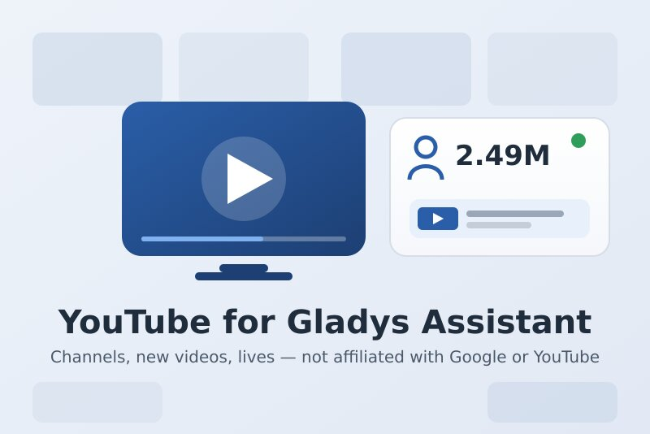
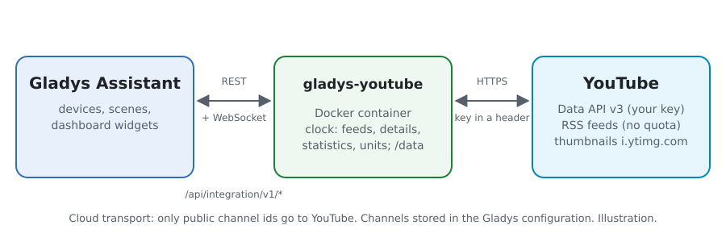
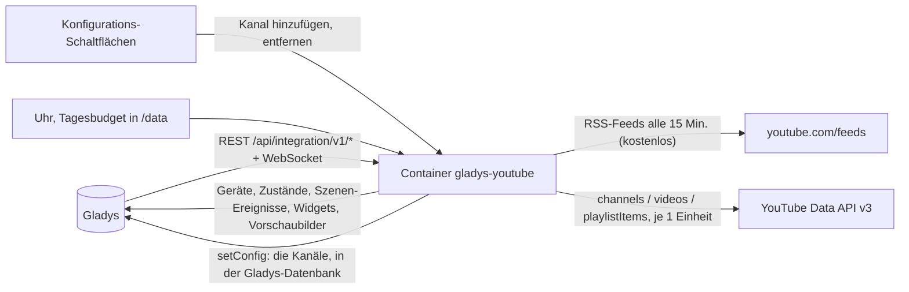
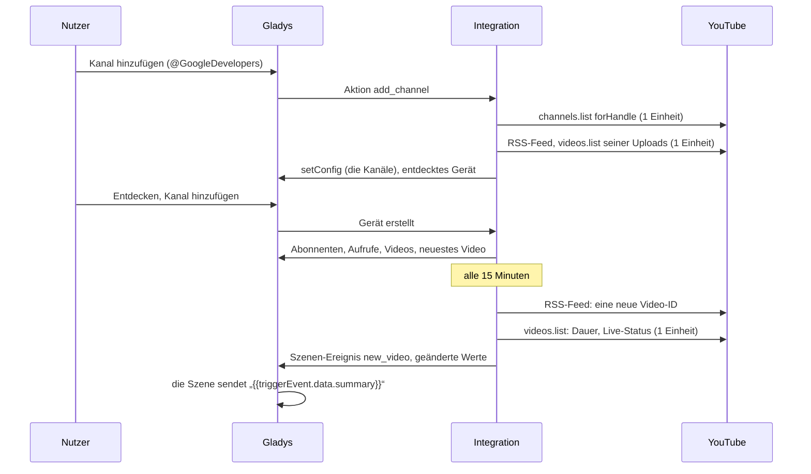
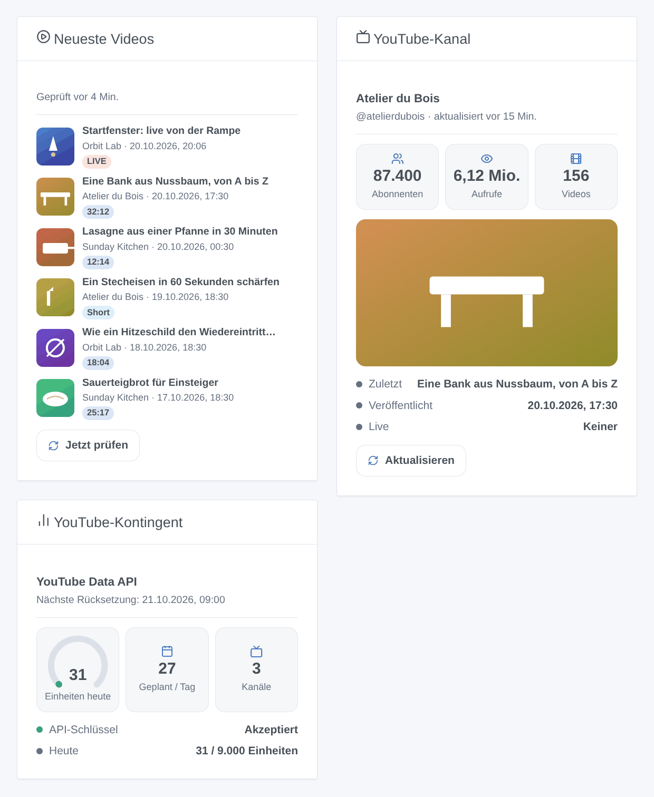

# Gladys YouTube

[English](README.md) · [Français](README.fr.md) · **Deutsch** · [Español](README.es.md)

[](LICENSE)
[](https://github.com/William-De71/gladys-youtube/releases)
[](https://github.com/William-De71/gladys-youtube/actions/workflows/release.yml)
[](https://gladysassistant.com)



Externe Integration für [Gladys Assistant](https://gladysassistant.com), die öffentliche YouTube-Kanäle verfolgt: Abonnenten, Aufrufe, Videos und neuestes Video als Geräte, Szenen bei einem neuen Video oder einem Livestream-Start und Dashboard-Widgets mit Vorschaubildern. Neue Videos werden über die öffentlichen RSS-Feeds erkannt (ohne Kontingent); die Statistiken kommen von der offiziellen YouTube Data API v3 mit Ihrem eigenen Google-Cloud-API-Schlüssel, innerhalb ihres kostenlosen Tageskontingents.

Benutzerdokumentation: [English](docs/en.md) · [Français](docs/fr.md) · [Deutsch](docs/de.md) · [Español](docs/es.md).

**Nicht mit Google oder YouTube verbunden, nicht von ihnen unterstützt oder gesponsert.** YouTube ist eine Marke von Google LLC. **Noch nicht mit einem echten API-Schlüssel getestet**: Die Anfragen folgen der Dokumentation der Data API v3, geprüft an ihren echten Fehlerantworten; RSS-Feeds und Shorts-Erkennung wurden live geprüft.

## Funktionen

- Kanäle per **einfachem Formular** hinzugefügt: ein @Handle, eine Kanal-URL, eine Kanal-ID (UC…) oder die URL eines seiner Videos; bis zu 50 Kanäle.
- **Ein Gerät pro Kanal**: Abonnenten, Aufrufe gesamt, Videos, Titel und Datum des neuesten Videos.
- **Neue Videos innerhalb von 15 Minuten** über die RSS-Feeds, kostenlos; Shorts unterschieden; geplante Livestreams um ihren Beginn alle 5 Minuten verfolgt.
- Ein **Tagesbudget an Einheiten** (standardmäßig 9.000 der 10.000 kostenlosen), pro pazifischem Tag gezählt wie bei Google; etwa 30 Einheiten pro Tag für 10 Kanäle.
- **5 Szenen-Auslöser**, **2 Szenen-Aktionen** und **3 Dashboard-Widgets** (unten), mit Links zu den Videos.
- Überall vier Sprachen: Englisch, Französisch, Deutsch, Spanisch.

## Funktionsweise





Vom neuen Kanal zur Szene:



### Transport

`transports: ["cloud"]`: Alles kommt von YouTube. Nur die IDs der verfolgten öffentlichen Kanäle (und ihrer Videos) werden gesendet, mit Ihrem API-Schlüssel für die Data API; nichts über Ihr Zuhause verlässt Ihr Gladys. Die Kanäle werden in der Gladys-Konfiguration gespeichert (und folgen ihren Sicherungen); `/data` behält die letzten Werte und den Einheitenzähler.

## Geräte und Funktionen

| Gerät           | Funktionen (Kategorie / Typ)                                                                                                                                    |
| --------------- | --------------------------------------------------------------------------------------------------------------------------------------------------------------- |
| Eines pro Kanal | Abonnenten, Aufrufe gesamt, Videos (`counter-sensor` / `integer`); neuestes Video und sein Veröffentlichungsdatum (`text` / `text`, in der Zeitzone von Gladys) |

Die External IDs beruhen auf der Kanal-ID (UC…), nie auf Titel oder Handle: Ein umbenannter Kanal behält sein Gerät und seinen Verlauf. YouTube rundet die öffentliche Abonnentenzahl auf drei signifikante Stellen ab; verbirgt ein Kanal sie, erhält die Funktion keinen Wert. Es gibt keine binäre „Live“-Funktion: Gladys hat keine Kategorie dafür, ein Livestream ist daher ein Szenen-Auslöser und ein Abzeichen der Widgets.

## Szenen-Auslöser, Aktionen und Widgets



**Widgets**: Neueste Videos (die Uploads Ihrer Kanäle mit Vorschaubild, Kanal, Datum, einem Abzeichen — LIVE, Geplant, Short oder die Dauer —, einem Link zum Video und einer Schaltfläche „Jetzt prüfen“; Einstellungen: Kanäle, Shorts anzeigen oder nicht), YouTube-Kanal (Vorschaubild des neuesten Videos, Abonnenten, Aufrufe, Videos, neuestes Video, Datum, Live-Status, „Aktualisieren“), YouTube-Kontingent (Einheiten des Tages, nächste Rücksetzung, pro Tag geplante Einheiten, Status des Schlüssels). Die Schaltflächen lesen die RSS-Feeds (kostenlos) und die Statistiken eines Kanals (1 Einheit); nie einen Kanal, der vor weniger als einer Minute geprüft wurde.

**Auslöser** (ein Ereignis pro Übergang, nie als Folge einer Aktion oder einer Schaltfläche):

- Ein Kanal veröffentlicht ein Video: ein neues Video oder Short, vor weniger als 48 Stunden veröffentlicht (ohne Livestreams). Filter: Kanal, Art (Video oder Short). Variablen: Kanalname, Titel, URL, Video-ID, Art, Short, Dauer, Veröffentlichungsdatum, Vorschaubild-URL, Zusammenfassung.
- Ein Kanal geht live: ein Livestream oder eine Premiere beginnt. Filter: Kanal. Variablen: Kanalname, Titel, URL, Beginn, geplanter Beginn, Vorschaubild-URL, Zusammenfassung.
- Ein Kanal erreicht eine Abonnentenmarke: 100, 200, 500, 1.000, 2.000, 5.000… je einmal (ein Rückgang und erneuter Anstieg löst nicht erneut aus). Filter: Kanal.
- Google lehnt den API-Schlüssel ab: einmal, bis eine Anfrage wieder gelingt. Variablen: Grund, Zusammenfassung (mit der Lösung).
- Das Tageskontingent ist erschöpft: das Budget der Integration, oder Google lehnt das Kontingent des Projekts ab; einmal pro Tag. Filter: Quelle.

Abonnenten, Aufrufe und Videos sind Gerätefunktionen: „mehr als 10.000 Abonnenten“ ist ein Geräte-Auslöser von Gladys.

**Aktionen**: das neueste Video eines Kanals abrufen (prüft jetzt seinen RSS-Feed, kostenlos; Titel, URL, Short, Dauer, Datum, Live-Status, Zusammenfassung); die Statistiken eines Kanals abrufen (Abonnenten, Aufrufe, Videos, Zusammenfassung; ohne Anfrage).

Beispiele:

- Wenn ein Kanal ein Video veröffentlicht (Art: Video, kein Short) → „{{triggerEvent.data.summary}}“ an die Familie senden.
- Wenn „Orbit Lab“ live geht → das Wohnzimmerlicht in den Kinomodus schalten und den Link senden.
- Jeden Abend um 19 Uhr → das neueste Video eines Kanals abrufen → seinen Titel mit der Sprachausgabe von Gladys vorlesen.

## Voraussetzungen

- Gladys Assistant **5.3.0** oder neuer (Widgets und Szenen der Integrationen; Katalog-Schlagwörter und -Länder von Gladys 5.3): Ältere Instanzen können die Integration nicht installieren.
- Ein **Google-Cloud-API-Schlüssel** mit aktivierter **YouTube Data API v3**. Kein Rechnungskonto nötig: Die API ist innerhalb ihres Tageskontingents kostenlos.

### Kosten

Kostenlos. Jeder Aufruf der Data API verbraucht Einheiten des Tageskontingents des Cloud-Projekts (standardmäßig 10.000 pro Tag, Rücksetzung um Mitternacht pazifischer Zeit; geprüft am 2026-10-20):

| Aufruf                                     | Einheiten | Wann                                                          |
| ------------------------------------------ | --------- | ------------------------------------------------------------- |
| channels.list (50 Kanäle)                  | 1         | alle 60 Minuten und beim Hinzufügen eines Kanals              |
| videos.list (50 Videos)                    | 1         | wenn neue Videos erscheinen und um einen geplanten Livestream |
| playlistItems.list                         | 1         | nur wenn der RSS-Feed eines Kanals ausfällt                   |
| RSS-Feed, Shorts-Erkennung, Vorschaubilder | 0         | alle 15 Minuten, für neue Videos, für die Widgets             |
| search.list (100 Einheiten, nie genutzt)   | —         | die Integration sucht nie: Sie geben den Kanal an             |

## Installation

- **Aus dem Store**: Integrationen → YouTube → Installieren.
- **Über die Repository-URL**: Integrationen → externe Integration → `https://github.com/William-De71/gladys-youtube`.
- **Entwicklermodus**: `npm start` mit den von Gladys gelieferten Variablen starten (siehe Entwicklung).

## Konfiguration

| Feld oder Schaltfläche                  | Standard    | Bedeutung                                                                       |
| --------------------------------------- | ----------- | ------------------------------------------------------------------------------- |
| Google-Cloud-API-Schlüssel              | —           | Pflicht, geheim; auf YouTube Data API v3 beschränken                            |
| Neue Videos: prüfen alle                | 15 Min.     | 5 bis 240; die RSS-Feeds, kostenlos                                             |
| Statistiken: lesen alle                 | 60 Min.     | 15 bis 1.440; 1 Einheit pro 50 Kanäle                                           |
| Tagesbudget                             | 9.000       | Einheiten pro Tag, die die Integration verbrauchen darf (Google gibt 10.000)    |
| Sprache der Texte                       | automatisch | Funktionsnamen, Daten, Szenen-Zusammenfassungen, Meldungen der Schaltflächen    |
| Kanal hinzufügen / entfernen            | —           | @Handle, URL, ID oder Video-URL; entfernen per Nummer, Name, Handle oder ID     |
| Kanäle auflisten / API-Schlüssel testen | —           | Abonnenten, neuestes Video, letzte Prüfung und Fehler; liest einen Kanal (1 E.) |

## Verwendung

1. Fügen Sie Ihren API-Schlüssel ein und drücken Sie **API-Schlüssel testen** (Integrationen → YouTube → Konfiguration).
2. **Fügen Sie einen Kanal** für jeden zu verfolgenden Kanal hinzu; seine letzten Uploads werden sofort gelesen (nie angekündigt).
3. **Entdecken** und die gewünschten Kanäle als Geräte hinzufügen.
4. Fügen Sie die Widgets einem Dashboard hinzu und bauen Sie Szenen mit den Gerätefunktionen, Auslösern und Aktionen.

## Entwicklung

```bash
npm install
npm test                       # node --test, nie mit Netzwerk
npm run lint                   # ESLint
npm run format:check           # Prettier
npx github:GladysAssistant/integration-store . --skip-image-check
scripts/build-cover.sh         # cover.jpg aus docs/assets/cover.svg
docs/illustrations/render.sh   # docs/assets/widgets.<lang>.png
```

Lokal liest das SDK `GLADYS_HOST_API_URL`, `GLADYS_INTEGRATION_TOKEN` und `GLADYS_INTEGRATION_SELECTOR` (von Gladys im Entwicklermodus geliefert), und die Integration liest `TZ`. `DEBUG=gladys-integration-sdk` zeigt die SDK-Logs.

Die Tests decken den YouTube-Client ab (Schlüssel im Header, Einheiten, Budget, Fehler, RSS-Auswertung, Shorts-Erkennung, Eingaben), den pazifischen Kontingenttag, das Register, die Geräte (die vom Entdecken-Bildschirm verlangten Felder), die Widgets (`validateWidgetContent`, `validateWidgetImage`), die Szenen-Ereignisse und -Ausgaben, die Uhr (Feeds, Details, Livestreams, Statistiken, Neustart, abgelehnter Schlüssel, Kontingent, Feed-Ausfall), das Manifest, die vier Sprachen, das Release-Skript und die ganze Integration gegen das Fake-Gladys des SDK und ein Fake-YouTube. `test/structure.test.js` friert alle beim Nutzer gespeicherten Schlüssel ein.

## Release-Prozess


Jeder Merge auf `main` startet die CI und berechnet dann die Version aus den [Conventional Commits](https://www.conventionalcommits.org/) seit dem letzten Tag: `feat` → Minor, `fix` / `perf` → Patch, `!` oder `BREAKING CHANGE` → Major (ein Minor vor 1.0.0); `docs`, `chore`, `ci`, `test`, `style`, `refactor`, `build` allein veröffentlichen nichts. Der Changelog-Abschnitt wird erzeugt, der Tag gepusht, das Multi-Architektur-Image gebaut, dann erhält `main` den Release-Commit, das GitHub Release wird erstellt und ein letzter Job prüft das öffentliche Image, den Store-Validator und das Topic.

- Der Titel des Pull Requests wird zum Squash-Commit und dann zur Changelog-Zeile: auf Englisch, für den Nutzer schreiben (`pr-title.yml` prüft ihn). `CHANGELOG.md` nie von Hand bearbeiten.
- 1.0.0 ist eine Entscheidung: Actions → Release → Run workflow mit `release-as: 1.0.0`. `dry-run` zeigt Version und Notizen, ohne zu veröffentlichen.
- **Geschützter Branch**: Das Release pusht seinen Commit mit `GITHUB_TOKEN` auf `main`. Das Ruleset `protect-main` (kein Löschen, kein Force-Push) lässt ihn durch; eine strengere Regel (Pull Request Pflicht, Status-Checks) bräuchte GitHub Actions in der Bypass-Liste oder eine GitHub App.
- Nach dem ersten Release das `ghcr.io`-Paket öffentlich machen (Package settings → Change visibility), sonst kann Gladys es nicht laden.

## Fehlerbehebung

Siehe [docs/de.md](docs/de.md#fehlerbehebung). Melden Sie Probleme mit den Versionen von Gladys und der Integration, dem Ergebnis von „Kanäle auflisten“ und den Logs der Integration. Fügen Sie nie Ihren API-Schlüssel ein.

## Mitwirken

Issues und Pull Requests sind willkommen. Führen Sie `npm run format:check && npm run lint && npm test` vor einem Pull Request aus und lassen Sie jede External ID und jeden gespeicherten Schlüssel unverändert (siehe [CLAUDE.md](CLAUDE.md)).

## Sicherheit

Siehe [SECURITY.md](SECURITY.md): Schwachstellen privat melden. Der API-Schlüssel ist ein `secret`-Feld: nie geloggt, nie in `/data` geschrieben, nur an `www.googleapis.com` in einem Header gesendet. Die Vorschaubilder kommen nur von `i.ytimg.com`, aus von der Integration erzeugten Schlüsseln.

## Kommende Screenshots

Die Bilder oben sind Illustrationen, keine Screenshots. Echte Screenshots kommen nach `docs/assets/screenshots/` (PNG, 1280 × 800): `configuration.png` (das Formular „Kanal hinzufügen“), `discovery.png`, `device.png`, `scene.png`.

## Lizenz

[Apache-Lizenz 2.0](LICENSE) — siehe auch [NOTICE](NOTICE). YouTube ist eine Marke von Google LLC; dieses Projekt ist nicht mit Google oder YouTube verbunden. Dank an die Dokumentation und das SDK von Gladys sowie an die YouTube-Integration von Home Assistant und ihre Bibliothek youtubeaio für die Funktionen und die Shorts-Erkennung.
