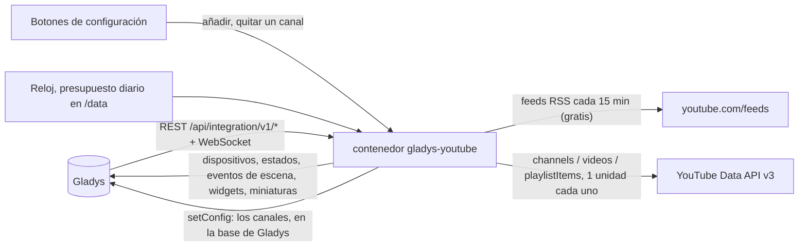
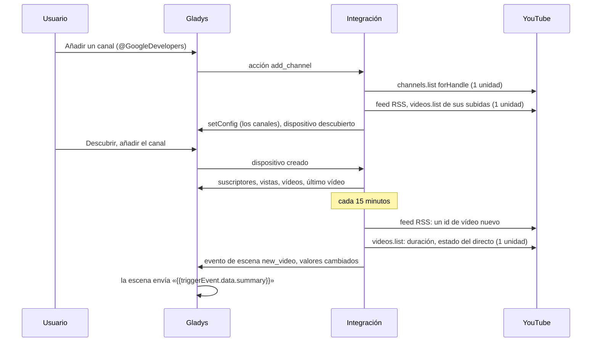
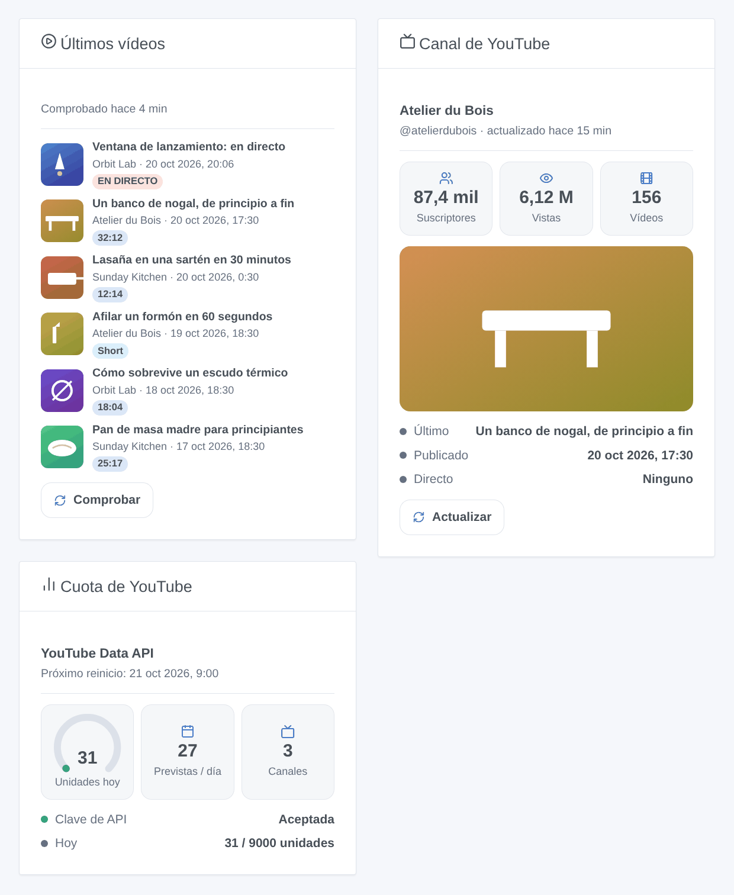

# Gladys YouTube

[English](README.md) · [Français](README.fr.md) · [Deutsch](README.de.md) · **Español**

[](LICENSE)
[](https://github.com/William-De71/gladys-youtube/releases)
[](https://github.com/William-De71/gladys-youtube/actions/workflows/release.yml)
[](https://gladysassistant.com)


Integración externa para [Gladys Assistant](https://gladysassistant.com) que sigue canales públicos de YouTube: suscriptores, vistas, vídeos y último vídeo como dispositivos, escenas cuando se publica un vídeo o empieza un directo, y widgets de panel con miniaturas. Los vídeos nuevos se detectan con los feeds RSS públicos (sin cuota); las estadísticas vienen de la API oficial YouTube Data API v3 con tu propia clave de API de Google Cloud, dentro de su cuota diaria gratuita.

Documentación de usuario: [English](docs/en.md) · [Français](docs/fr.md) · [Deutsch](docs/de.md) · [Español](docs/es.md).

**Sin afiliación con Google ni YouTube, ni respaldada ni patrocinada por ellos.** YouTube es una marca de Google LLC. **Aún no probada con una clave de API real**: las solicitudes siguen la documentación de la Data API v3, comprobada con sus respuestas de error reales; los feeds RSS y la detección de Shorts se comprobaron en real.

## Funciones

- Canales añadidos con **un formulario sencillo**: un @identificador, la URL de un canal, un id de canal (UC…) o la URL de uno de sus vídeos; hasta 50 canales.
- **Un dispositivo por canal**: suscriptores, vistas totales, vídeos, título y fecha del último vídeo.
- **Vídeos nuevos en 15 minutos** con los feeds RSS, gratis; Shorts diferenciados; directos programados seguidos cada 5 minutos alrededor de su inicio.
- Un **presupuesto diario de unidades** (9.000 de las 10.000 gratuitas por defecto), contado por día del Pacífico como Google; unas 30 unidades al día para 10 canales.
- **5 disparadores de escena**, **2 acciones de escena** y **3 widgets** (abajo), con enlaces a los vídeos.
- Cuatro idiomas en todas partes: inglés, francés, alemán, español.

## Funcionamiento




De un canal nuevo a una escena:



### Transporte

`transports: ["cloud"]`: todo viene de YouTube. Solo se envían los ids de los canales públicos seguidos (y de sus vídeos), con tu clave de API para la Data API; nada de tu casa sale de tu Gladys. Los canales se guardan en la configuración de Gladys (y siguen sus copias de seguridad); `/data` guarda las últimas lecturas y el contador de unidades.

## Dispositivos y funciones

| Dispositivo   | Funciones (categoría / tipo)                                                                                                                                |
| ------------- | ----------------------------------------------------------------------------------------------------------------------------------------------------------- |
| Uno por canal | Suscriptores, vistas totales, vídeos (`counter-sensor` / `integer`); último vídeo y su fecha de publicación (`text` / `text`, en la zona horaria de Gladys) |

Los external ids se basan en el id del canal (UC…), nunca en su título ni en su identificador: un canal renombrado conserva su dispositivo y su historial. YouTube redondea hacia abajo el número público de suscriptores a tres cifras significativas; cuando un canal lo oculta, la función no recibe valor. No hay función binaria «en directo»: Gladys no tiene categoría para ello, así que un directo es un disparador de escena y un distintivo de los widgets.

## Disparadores, acciones de escena y widgets



**Widgets**: Últimos vídeos (las subidas de tus canales con miniatura, canal, fecha, un distintivo — EN DIRECTO, Programado, Short o la duración —, un enlace al vídeo y un botón «Comprobar»; ajustes: canales, Shorts mostrados o no), Canal de YouTube (miniatura del último vídeo, suscriptores, vistas, vídeos, último vídeo, fecha, estado del directo, «Actualizar»), Cuota de YouTube (unidades del día, próximo reinicio, unidades previstas al día, estado de la clave). Los botones leen los feeds RSS (gratis) y las estadísticas de un canal (1 unidad); nunca un canal comprobado hace menos de un minuto.

**Disparadores** (un evento por transición, nunca como consecuencia de una acción o de un botón):

- Un canal publica un vídeo: un vídeo o Short nuevo, publicado hace menos de 48 horas (sin directos). Filtros: canal, tipo (vídeo o Short). Variables: nombre del canal, título, URL, id del vídeo, tipo, Short, duración, fecha de publicación, URL de la miniatura, resumen.
- Un canal empieza un directo: empieza un directo o un estreno. Filtro: canal. Variables: nombre del canal, título, URL, inicio, inicio previsto, URL de la miniatura, resumen.
- Un canal alcanza un hito de suscriptores: 100, 200, 500, 1.000, 2.000, 5.000… una vez cada uno (bajar y volver a subir no lo vuelve a activar). Filtro: canal.
- Google rechaza la clave de API: una vez, hasta que una solicitud vuelva a funcionar. Variables: motivo, resumen (con qué corregir).
- La cuota del día se ha agotado: el presupuesto de la integración, o Google rechaza la cuota del proyecto; una vez al día. Filtro: origen.

Los suscriptores, vistas y vídeos son funciones del dispositivo: «más de 10.000 suscriptores» es un disparador de dispositivo de Gladys.

**Acciones**: obtener el último vídeo de un canal (comprueba ahora su feed RSS, gratis; título, URL, Short, duración, fecha, estado del directo, resumen); obtener las estadísticas de un canal (suscriptores, vistas, vídeos, resumen; sin solicitud).

Ejemplos:

- Cuando un canal publica un vídeo (tipo: vídeo, no Short) → enviar «{{triggerEvent.data.summary}}» a la familia.
- Cuando «Orbit Lab» empieza un directo → poner las luces del salón en modo cine y enviar el enlace.
- Cada tarde a las 19:00 → obtener el último vídeo de un canal → leer su título en voz alta con la síntesis de voz de Gladys.

## Requisitos

- Gladys Assistant **5.3.0** o posterior (widgets y escenas de las integraciones; palabras clave y países del catálogo de Gladys 5.3): las instancias más antiguas no pueden instalar la integración.
- Una **clave de API de Google Cloud** con **YouTube Data API v3** activada. No hace falta cuenta de facturación: la API es gratuita dentro de su cuota diaria.

### Coste

Gratis. Cada llamada a la Data API consume unidades de la cuota diaria del proyecto Cloud (10.000 al día por defecto, reiniciadas a la medianoche del Pacífico; comprobado el 2026-10-20):

| Llamada                                   | Unidades | Cuándo                                                    |
| ----------------------------------------- | -------- | --------------------------------------------------------- |
| channels.list (50 canales)                | 1        | cada 60 minutos, y al añadir un canal                     |
| videos.list (50 vídeos)                   | 1        | cuando aparecen vídeos nuevos, y alrededor de un directo  |
| playlistItems.list                        | 1        | solo cuando falla el feed RSS de un canal                 |
| Feed RSS, detección de Shorts, miniaturas | 0        | cada 15 minutos, para los vídeos nuevos, para los widgets |
| search.list (100 unidades, nunca usado)   | —        | la integración nunca busca: tú indicas el canal           |

## Instalación

- **Desde la tienda**: Integraciones → YouTube → Instalar.
- **Desde la URL del repositorio**: Integraciones → integración externa → `https://github.com/William-De71/gladys-youtube`.
- **Modo desarrollador**: ejecuta `npm start` con las variables que da Gladys (ver Desarrollo).

## Configuración

| Campo o botón                        | Por defecto | Significado                                                                           |
| ------------------------------------ | ----------- | ------------------------------------------------------------------------------------- |
| Clave de API de Google Cloud         | —           | Obligatoria, secreta; restríngela a YouTube Data API v3                               |
| Vídeos nuevos: comprobar cada        | 15 min      | 5 a 240; los feeds RSS, gratis                                                        |
| Estadísticas: leer cada              | 60 min      | 15 a 1.440; 1 unidad por cada 50 canales                                              |
| Presupuesto diario                   | 9.000       | Unidades al día que la integración puede gastar (Google da 10.000)                    |
| Idioma de los textos                 | automático  | Nombres de funciones, fechas, resúmenes de escenas, mensajes de los botones           |
| Añadir / Quitar un canal             | —           | @identificador, URL, id o URL de vídeo; quitar por número, nombre, identificador o id |
| Listar los canales / Probar la clave | —           | Suscriptores, último vídeo, última comprobación y error; lee un canal (1 u)           |

## Uso

1. Pega tu clave de API y pulsa **Probar la clave de API** (Integraciones → YouTube → Configuración).
2. **Añade un canal** por cada canal que seguir; sus últimas subidas se leen enseguida (nunca se anuncian).
3. **Descubrir** y añade los canales que quieras como dispositivos.
4. Añade los widgets a un panel y crea escenas con las funciones del dispositivo, los disparadores y las acciones.

## Desarrollo

```bash
npm install
npm test                       # node --test, nunca toca la red
npm run lint                   # ESLint
npm run format:check           # Prettier
npx github:GladysAssistant/integration-store . --skip-image-check
scripts/build-cover.sh         # cover.jpg desde docs/assets/cover.svg
docs/illustrations/render.sh   # docs/assets/widgets.<lang>.png
```

En local, el SDK lee `GLADYS_HOST_API_URL`, `GLADYS_INTEGRATION_TOKEN` y `GLADYS_INTEGRATION_SELECTOR` (que da Gladys en modo desarrollador), y la integración lee `TZ`. `DEBUG=gladys-integration-sdk` muestra los registros del SDK.

Las pruebas cubren el cliente de YouTube (clave en una cabecera, unidades, presupuesto, errores, lectura del RSS, detección de Shorts, entradas), el día de cuota del Pacífico, el registro, los dispositivos (los campos que exige la pantalla Descubrir), los widgets (`validateWidgetContent`, `validateWidgetImage`), los eventos y salidas de escena, el reloj (feeds, detalles, directos, estadísticas, reinicio, clave rechazada, cuota, feed caído), el manifiesto, los cuatro idiomas, el script de release y la integración completa frente al Gladys falso del SDK y un YouTube falso. `test/structure.test.js` congela todas las claves guardadas por el usuario.

## Proceso de release


Cada fusión en `main` lanza la CI y luego calcula la versión a partir de los [Conventional Commits](https://www.conventionalcommits.org/) desde la última etiqueta: `feat` → menor, `fix` / `perf` → parche, `!` o `BREAKING CHANGE` → mayor (una menor antes de 1.0.0); `docs`, `chore`, `ci`, `test`, `style`, `refactor`, `build` solos no publican nada. Se genera la sección del changelog, se empuja la etiqueta, se construye la imagen multiarquitectura, luego `main` recibe el commit de release, se crea la GitHub Release y un último job comprueba la imagen pública, el validador de la tienda y el topic.

- El título de la pull request se convierte en el commit squash y luego en la línea del changelog: escríbelo en inglés, para el usuario (`pr-title.yml` lo comprueba). Nunca edites `CHANGELOG.md` a mano.
- La 1.0.0 es una decisión: Actions → Release → Run workflow con `release-as: 1.0.0`. `dry-run` muestra la versión y las notas sin publicar.
- **Rama protegida**: la release empuja su commit a `main` con `GITHUB_TOKEN`. El ruleset `protect-main` (sin borrado ni force-push) lo deja pasar; una regla más estricta (pull request obligatoria, status checks) necesitaría GitHub Actions en su lista de omisión, o una GitHub App.
- Tras la primera release, haz público el paquete `ghcr.io` (Package settings → Change visibility), o Gladys no podrá descargarlo.

## Solución de problemas

Ver [docs/es.md](docs/es.md#solución-de-problemas). Informa de los problemas con las versiones de Gladys y de la integración, el resultado de «Listar los canales» y los registros de la integración. Nunca pegues tu clave de API.

## Contribuir

Issues y pull requests bienvenidas. Ejecuta `npm run format:check && npm run lint && npm test` antes de abrir una pull request, y no cambies ningún external id ni ninguna clave guardada (ver [CLAUDE.md](CLAUDE.md)).

## Seguridad

Ver [SECURITY.md](SECURITY.md): informa de las vulnerabilidades en privado. La clave de API es un campo `secret`: nunca registrada, nunca escrita en `/data`, enviada solo a `www.googleapis.com` en una cabecera. Las miniaturas solo vienen de `i.ytimg.com`, a partir de claves creadas por la integración.

## Capturas por venir

Las imágenes de arriba son ilustraciones, no capturas de pantalla. Las capturas reales irán en `docs/assets/screenshots/` (PNG, 1280 × 800): `configuration.png` (el formulario «Añadir un canal»), `discovery.png`, `device.png`, `scene.png`.

## Licencia

[Licencia Apache 2.0](LICENSE) — ver también [NOTICE](NOTICE). YouTube es una marca de Google LLC; este proyecto no está afiliado a Google ni a YouTube. Gracias a la documentación y al SDK de Gladys, y a la integración YouTube de Home Assistant y su biblioteca youtubeaio por las funciones y la detección de Shorts.
