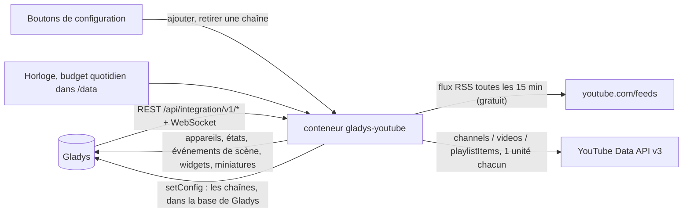
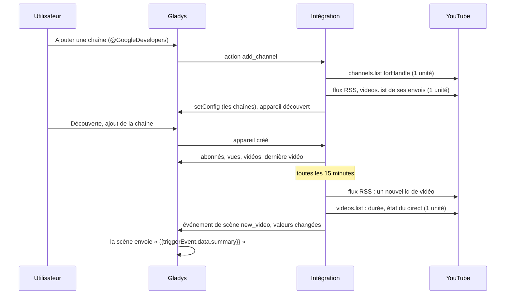
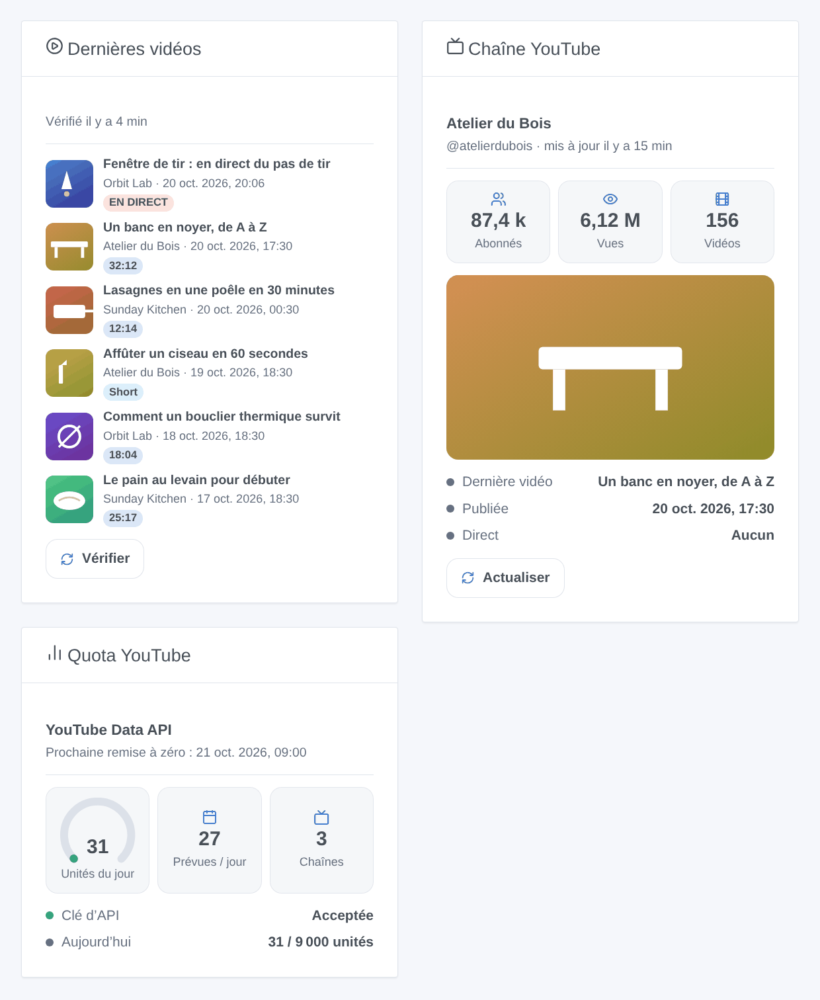

# Gladys YouTube

[English](README.md) · **Français** · [Deutsch](README.de.md) · [Español](README.es.md)

[](LICENSE)
[](https://github.com/William-De71/gladys-youtube/releases)
[](https://github.com/William-De71/gladys-youtube/actions/workflows/release.yml)
[](https://gladysassistant.com)


Intégration externe pour [Gladys Assistant](https://gladysassistant.com) qui suit des chaînes YouTube publiques : abonnés, vues, vidéos et dernière vidéo en appareils, scènes quand une vidéo est publiée ou qu’un direct commence, et widgets de tableau de bord avec miniatures. Les nouvelles vidéos sont détectées par les flux RSS publics (sans quota) ; les statistiques viennent de l’API officielle YouTube Data API v3 avec votre propre clé d’API Google Cloud, dans son quota quotidien gratuit.

Documentation utilisateur : [English](docs/en.md) · [Français](docs/fr.md) · [Deutsch](docs/de.md) · [Español](docs/es.md).

**Non affilié à Google ni à YouTube, ni approuvé ni sponsorisé par eux.** YouTube est une marque de Google LLC. **Pas encore testé avec une vraie clé d’API** : les requêtes suivent la documentation de la Data API v3, vérifiée sur ses vraies réponses d’erreur ; les flux RSS et la détection des Shorts ont été vérifiés en réel.

## Fonctionnalités

- Chaînes ajoutées par **un simple formulaire** : un @identifiant, l’URL d’une chaîne, un id de chaîne (UC…) ou l’URL d’une de ses vidéos ; jusqu’à 50 chaînes.
- **Un appareil par chaîne** : abonnés, vues totales, vidéos, titre et date de la dernière vidéo.
- **Nouvelles vidéos en 15 minutes** par les flux RSS, gratuitement ; Shorts distingués ; directs programmés suivis toutes les 5 minutes autour de leur début.
- Un **budget quotidien d’unités** (9 000 des 10 000 gratuites par défaut), compté par jour du Pacifique comme Google ; environ 30 unités par jour pour 10 chaînes.
- **5 déclencheurs de scène**, **2 actions de scène** et **3 widgets** (ci-dessous), avec les liens vers les vidéos.
- Quatre langues partout : anglais, français, allemand, espagnol.

## Fonctionnement




D’une nouvelle chaîne à une scène :



### Transport

`transports: ["cloud"]` : tout vient de YouTube. Seuls les ids des chaînes publiques suivies (et de leurs vidéos) sont envoyés, avec votre clé d’API pour la Data API ; rien de votre maison ne quitte votre Gladys. Les chaînes sont stockées dans la configuration de Gladys (et suivent ses sauvegardes) ; `/data` garde les dernières lectures et le compteur d’unités.

## Appareils et fonctionnalités

| Appareil      | Fonctionnalités (catégorie / type)                                                                                                                  |
| ------------- | --------------------------------------------------------------------------------------------------------------------------------------------------- |
| Un par chaîne | Abonnés, vues totales, vidéos (`counter-sensor` / `integer`) ; dernière vidéo et sa date de publication (`text` / `text`, dans le fuseau de Gladys) |

Les external ids reposent sur l’id de la chaîne (UC…), jamais sur son titre ni son identifiant : une chaîne renommée garde son appareil et son historique. YouTube arrondit à l’inférieur le nombre public d’abonnés à trois chiffres significatifs ; quand une chaîne le masque, la fonctionnalité ne reçoit pas de valeur. Il n’y a pas de fonctionnalité binaire « en direct » : Gladys n’a pas de catégorie pour cela, un direct est donc un déclencheur de scène et un badge des widgets.

## Déclencheurs, actions de scène et widgets



**Widgets** : Dernières vidéos (les envois de vos chaînes avec miniature, chaîne, date, un badge — EN DIRECT, Programmé, Short ou la durée — un lien vers la vidéo et un bouton « Vérifier » ; réglages : chaînes, Shorts affichés ou non), Chaîne YouTube (miniature de la dernière vidéo, abonnés, vues, vidéos, dernière vidéo, date, état du direct, « Actualiser »), Quota YouTube (unités du jour, prochaine remise à zéro, unités prévues par jour, état de la clé). Les boutons lisent les flux RSS (gratuit) et les statistiques d’une chaîne (1 unité) ; jamais une chaîne vérifiée il y a moins d’une minute.

**Déclencheurs** (un événement par transition, jamais en conséquence d’une action ou d’un bouton) :

- Une chaîne publie une vidéo : une nouvelle vidéo ou un Short, publié il y a moins de 48 heures (hors directs). Filtres : chaîne, type (vidéo ou Short). Variables : nom de la chaîne, titre, URL, id de la vidéo, type, Short, durée, date de publication, URL de la miniature, résumé.
- Une chaîne passe en direct : un direct ou une première commence. Filtre : chaîne. Variables : nom de la chaîne, titre, URL, début, début prévu, URL de la miniature, résumé.
- Une chaîne franchit un palier d’abonnés : 100, 200, 500, 1 000, 2 000, 5 000… une fois chacun (repasser en dessous puis au-dessus ne redéclenche pas). Filtre : chaîne.
- Google refuse la clé d’API : une fois, jusqu’à ce qu’une requête fonctionne de nouveau. Variables : raison, résumé (avec quoi corriger).
- Le quota du jour est épuisé : le budget de l’intégration, ou Google refuse le quota du projet ; une fois par jour. Filtre : origine.

Les abonnés, vues et vidéos sont des fonctionnalités d’appareil : « plus de 10 000 abonnés » est un déclencheur d’appareil de Gladys.

**Actions** : obtenir la dernière vidéo d’une chaîne (vérifie son flux RSS maintenant, gratuit ; titre, URL, Short, durée, date, état du direct, résumé) ; obtenir les statistiques d’une chaîne (abonnés, vues, vidéos, résumé ; sans requête).

Exemples :

- Quand une chaîne publie une vidéo (type : vidéo, pas Short) → envoyer « {{triggerEvent.data.summary}} » à la famille.
- Quand « Orbit Lab » passe en direct → passer les lumières du salon en mode cinéma et envoyer le lien.
- Chaque soir à 19 h → obtenir la dernière vidéo d’une chaîne → lire son titre à voix haute avec la synthèse vocale de Gladys.

## Prérequis

- Gladys Assistant **5.1.0** ou plus récent (widgets et scènes des intégrations) : les instances plus anciennes ne peuvent pas installer l’intégration.
- Une **clé d’API Google Cloud** avec **YouTube Data API v3** activée. Aucun compte de facturation n’est nécessaire : l’API est gratuite dans son quota quotidien.

### Coût

Gratuit. Chaque appel à la Data API consomme des unités du quota quotidien du projet Cloud (10 000 par jour par défaut, remises à zéro à minuit heure du Pacifique ; vérifié le 2026-10-20) :

| Appel                                      | Unités | Quand                                                         |
| ------------------------------------------ | ------ | ------------------------------------------------------------- |
| channels.list (50 chaînes)                 | 1      | toutes les 60 minutes, et à l’ajout d’une chaîne              |
| videos.list (50 vidéos)                    | 1      | quand de nouvelles vidéos arrivent, et autour d’un direct     |
| playlistItems.list                         | 1      | seulement quand le flux RSS d’une chaîne échoue               |
| Flux RSS, détection des Shorts, miniatures | 0      | toutes les 15 minutes, pour les nouvelles vidéos, les widgets |
| search.list (100 unités, jamais appelé)    | —      | l’intégration ne cherche jamais : vous donnez la chaîne       |

## Installation

- **Depuis le store** : Intégrations → YouTube → Installer.
- **Depuis l’URL du dépôt** : Intégrations → intégration externe → `https://github.com/William-De71/gladys-youtube`.
- **Mode développeur** : lancez `npm start` avec les variables fournies par Gladys (voir Développement).

## Configuration

| Champ ou bouton                        | Défaut      | Rôle                                                                               |
| -------------------------------------- | ----------- | ---------------------------------------------------------------------------------- |
| Clé d’API Google Cloud                 | —           | Obligatoire, secrète ; restreignez-la à YouTube Data API v3                        |
| Nouvelles vidéos : vérifier toutes les | 15 min      | 5 à 240 ; les flux RSS, gratuits                                                   |
| Statistiques : lire toutes les         | 60 min      | 15 à 1 440 ; 1 unité pour 50 chaînes                                               |
| Budget quotidien                       | 9 000       | Unités par jour que l’intégration peut dépenser (Google en donne 10 000)           |
| Langue des textes                      | automatique | Noms des fonctionnalités, dates, résumés des scènes, messages des boutons          |
| Ajouter / Retirer une chaîne           | —           | @identifiant, URL, id ou URL de vidéo ; retrait par numéro, nom, identifiant ou id |
| Lister les chaînes / Tester la clé     | —           | Abonnés, dernière vidéo, dernière vérification et erreur ; lit une chaîne (1 u)    |

## Utilisation

1. Collez votre clé d’API, puis appuyez sur **Tester la clé d’API** (Intégrations → YouTube → Configuration).
2. **Ajoutez une chaîne** pour chaque chaîne à suivre ; ses derniers envois sont lus aussitôt (jamais annoncés).
3. **Découverte**, puis ajoutez les chaînes voulues comme appareils.
4. Ajoutez les widgets à un tableau de bord, et construisez vos scènes avec les fonctionnalités, les déclencheurs et les actions.

## Développement

```bash
npm install
npm test                       # node --test, ne touche jamais le réseau
npm run lint                   # ESLint
npm run format:check           # Prettier
npx github:GladysAssistant/integration-store . --skip-image-check
scripts/build-cover.sh         # cover.jpg depuis docs/assets/cover.svg
docs/illustrations/render.sh   # docs/assets/widgets.<lang>.png
```

En local, le SDK lit `GLADYS_HOST_API_URL`, `GLADYS_INTEGRATION_TOKEN` et `GLADYS_INTEGRATION_SELECTOR` (fournis par Gladys en mode développeur), et l’intégration lit `TZ`. `DEBUG=gladys-integration-sdk` affiche les journaux du SDK.

Les tests couvrent le client YouTube (clé dans un en-tête, unités, budget, erreurs, lecture du RSS, détection des Shorts, saisies), le jour de quota du Pacifique, le registre, les appareils (les champs qu’exige l’écran Découverte), les widgets (`validateWidgetContent`, `validateWidgetImage`), les événements et sorties de scène, l’horloge (flux, détails, directs, statistiques, redémarrage, clé refusée, quota, flux en panne), le manifeste, les quatre langues, le script de release, et l’intégration entière face au faux Gladys du SDK et à un faux YouTube. `test/structure.test.js` fige toutes les clés stockées chez l’utilisateur.

## Processus de release


Chaque fusion sur `main` lance la CI, puis calcule la version à partir des [Conventional Commits](https://www.conventionalcommits.org/) depuis le dernier tag : `feat` → mineure, `fix` / `perf` → correctif, `!` ou `BREAKING CHANGE` → majeure (une mineure avant 1.0.0) ; `docs`, `chore`, `ci`, `test`, `style`, `refactor`, `build` seuls ne publient rien. La section du changelog est générée, le tag poussé, l’image multi-architecture construite, puis `main` reçoit le commit de release, la GitHub Release est créée et un dernier job vérifie l’image publique, le validateur du store et le topic.

- Le titre de la pull request devient le commit squash, puis la ligne du changelog : écrivez-le en anglais, pour l’utilisateur (`pr-title.yml` le vérifie). N’éditez jamais `CHANGELOG.md` à la main.
- La 1.0.0 est une décision : Actions → Release → Run workflow avec `release-as: 1.0.0`. `dry-run` affiche la version et les notes sans rien publier.
- **Branche protégée** : la release pousse son commit sur `main` avec `GITHUB_TOKEN`. Le ruleset `protect-main` (ni suppression, ni force-push) le laisse passer ; une règle plus stricte (pull request obligatoire, status checks) demanderait GitHub Actions dans sa liste de contournement, ou une GitHub App.
- Après la première release, rendez public le package `ghcr.io` (Package settings → Change visibility), sinon Gladys ne peut pas le télécharger.

## Dépannage

Voir [docs/fr.md](docs/fr.md#dépannage). Signalez les problèmes avec les versions de Gladys et de l’intégration, le résultat de « Lister les chaînes » et les journaux de l’intégration. Ne collez jamais votre clé d’API.

## Contribuer

Issues et pull requests bienvenues. Lancez `npm run format:check && npm run lint && npm test` avant d’ouvrir une pull request, et ne changez aucun external id ni aucune clé stockée (voir [CLAUDE.md](CLAUDE.md)).

## Sécurité

Voir [SECURITY.md](SECURITY.md) : signalez les failles en privé. La clé d’API est un champ `secret` : jamais journalisée, jamais écrite dans `/data`, envoyée seulement à `www.googleapis.com` dans un en-tête. Les miniatures ne viennent que de `i.ytimg.com`, d’après des clés produites par l’intégration.

## Captures à venir

Les images ci-dessus sont des illustrations, pas des captures d’écran. Les vraies captures iront dans `docs/assets/screenshots/` (PNG, 1280 × 800) : `configuration.png` (le formulaire « Ajouter une chaîne »), `discovery.png`, `device.png`, `scene.png`.

## Licence

[Licence Apache 2.0](LICENSE) — voir aussi [NOTICE](NOTICE). YouTube est une marque de Google LLC ; ce projet n’est pas affilié à Google ni à YouTube. Merci à la documentation et au SDK de Gladys, ainsi qu’à l’intégration YouTube de Home Assistant et à sa bibliothèque youtubeaio pour les fonctionnalités et la détection des Shorts.
