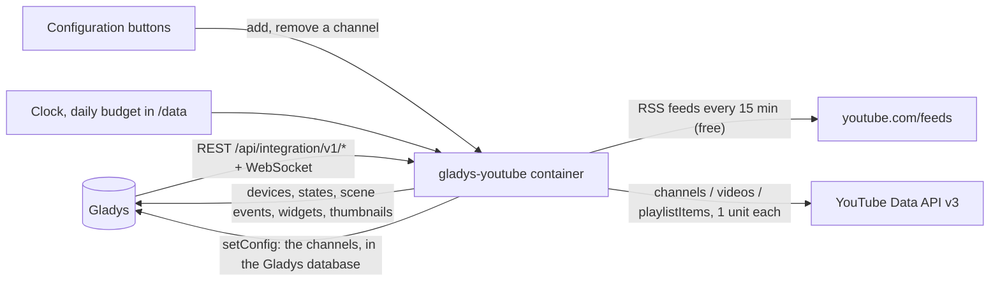
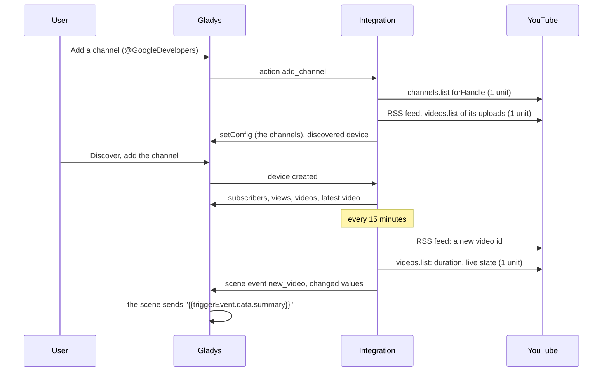
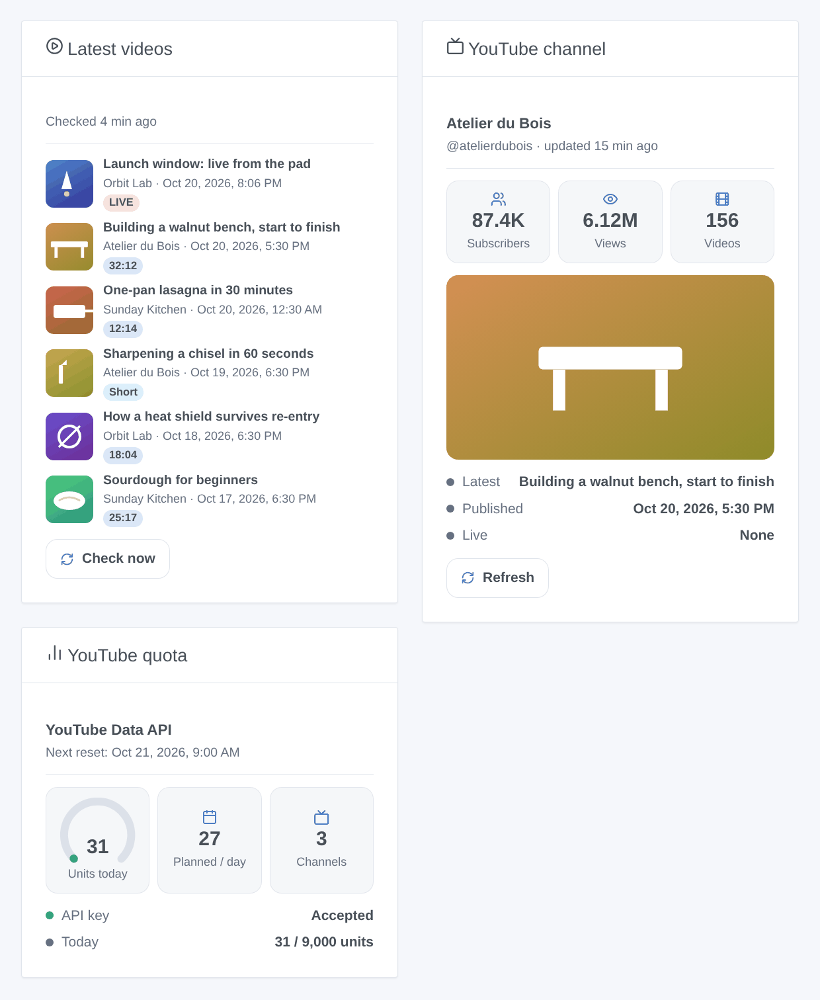

# Gladys YouTube

**English** · [Français](README.fr.md) · [Deutsch](README.de.md) · [Español](README.es.md)

[](LICENSE)
[](https://github.com/William-De71/gladys-youtube/releases)
[](https://github.com/William-De71/gladys-youtube/actions/workflows/release.yml)
[](https://gladysassistant.com)


[Gladys Assistant](https://gladysassistant.com) external integration that follows public YouTube channels: subscribers, views, videos and latest video as devices, scenes when a video is published or a live starts, and dashboard widgets with thumbnails. New videos are detected through the public RSS feeds (no quota); the statistics come from the official YouTube Data API v3 with your own Google Cloud API key, within its free daily quota.

User documentation: [English](docs/en.md) · [Français](docs/fr.md) · [Deutsch](docs/de.md) · [Español](docs/es.md).

**Not affiliated with, endorsed by nor sponsored by Google or YouTube.** YouTube is a trademark of Google LLC. **Not tested with a real API key yet**: the requests follow the documentation of the Data API v3, checked against its real error answers; the RSS feeds and the Shorts check were checked live.

## Features

- Channels added with **a plain form**: an @handle, a channel URL, a channel id (UC…) or the URL of one of its videos; up to 50 channels.
- **One device per channel**: subscribers, total views, videos, title and date of the latest video.
- **New videos within 15 minutes** through the RSS feeds, free; Shorts told apart; scheduled lives followed every 5 minutes around their start.
- A **daily budget of units** (9,000 of the 10,000 free ones by default), counted per Pacific day like Google; about 30 units a day for 10 channels.
- **5 scene triggers**, **2 scene actions** and **3 dashboard widgets** (below), with links to the videos.
- Four languages everywhere: English, French, German, Spanish.

## How it works




From a new channel to a scene:



### Transport

`transports: ["cloud"]`: everything comes from YouTube. Only the ids of the public channels you follow (and of their videos) are sent, with your API key for the Data API; nothing about your home leaves your Gladys. The channels are stored in the Gladys configuration (and follow its backups); `/data` keeps the last readings and the unit counter.

## Devices and features

| Device          | Features (category / type)                                                                                                                       |
| --------------- | ------------------------------------------------------------------------------------------------------------------------------------------------ |
| One per channel | Subscribers, total views, videos (`counter-sensor` / `integer`); latest video and its publication date (`text` / `text`, in the Gladys timezone) |

External ids rest on the channel id (UC…), never on its title nor its handle: a renamed channel keeps its device and its history. YouTube rounds the public subscriber count down to three significant figures; when a channel hides it, the feature gets no value. There is no "live" binary feature: Gladys has no category for it, so a live start is a scene trigger and a badge of the widgets.

## Scene triggers, actions and widgets



**Widgets**: Latest videos (the uploads of your channels with thumbnail, channel, date, a badge — LIVE, Scheduled, Short or the duration — a link to the video and a "Check now" button; settings: channels, Shorts shown or not), YouTube channel (thumbnail of the latest video, subscribers, views, videos, latest video, date, live state, "Refresh"), YouTube quota (units of the day, next reset, units planned a day, state of the key). The buttons read the RSS feeds (free) and the statistics of one channel (1 unit); never a channel checked less than a minute ago.

**Triggers** (one event per transition, never as the result of an action or a button):

- A channel publishes a video: a new video or Short, published less than 48 hours ago (lives excluded). Filters: channel, kind (video or Short). Variables: channel name, title, URL, video id, kind, Short, duration, publication date, thumbnail URL, summary.
- A channel goes live: a live or a premiere starts. Filter: channel. Variables: channel name, title, URL, start, scheduled start, thumbnail URL, summary.
- A channel reaches a subscriber milestone: 100, 200, 500, 1,000, 2,000, 5,000… once each (a dip below and back does not fire again). Filter: channel.
- Google refuses the API key: once, until a request works again. Variables: reason, summary (with what to fix).
- The daily quota is spent: the budget of the integration, or Google refuses the quota of the project; once a day. Filter: source.

Subscribers, views and videos are device features: "more than 10,000 subscribers" is a device trigger of Gladys.

**Actions**: get the latest video of a channel (checks its RSS feed now, free; title, URL, Short, duration, date, live state, summary); get the statistics of a channel (subscribers, views, videos, summary; no request).

Examples:

- When a channel publishes a video (kind: video, not Short) → send "{{triggerEvent.data.summary}}" to the family.
- When "Orbit Lab" goes live → turn the living room lights to cinema mode and send the link.
- Every evening at 19:00 → get the latest video of a channel → read its title aloud with the text-to-speech of Gladys.

## Requirements

- Gladys Assistant **5.3.0** or later (widgets and scenes of integrations; catalog keywords and countries of Gladys 5.3): older instances cannot install the integration.
- A **Google Cloud API key** with **YouTube Data API v3** enabled. No billing account is needed: the API is free within its daily quota.

### Cost

Free. Each Data API call costs units of the daily quota of the Cloud project (10,000 a day by default, reset at midnight Pacific Time; checked on 2026-10-20):

| Call                                  | Units | When                                                 |
| ------------------------------------- | ----- | ---------------------------------------------------- |
| channels.list (50 channels)           | 1     | every 60 minutes, and when a channel is added        |
| videos.list (50 videos)               | 1     | when new videos appear, and around a scheduled live  |
| playlistItems.list                    | 1     | only when the RSS feed of a channel fails            |
| RSS feed, Shorts check, thumbnails    | 0     | every 15 minutes, for new videos, for the widgets    |
| search.list (100 units, never called) | —     | the integration never searches: you give the channel |

## Installation

- **From the store**: Integrations → YouTube → Install.
- **From the repository URL**: Integrations → external integration → `https://github.com/William-De71/gladys-youtube`.
- **Developer mode**: run `npm start` with the variables given by Gladys (see Development).

## Configuration

| Field or button                      | Default   | Meaning                                                                  |
| ------------------------------------ | --------- | ------------------------------------------------------------------------ |
| Google Cloud API key                 | —         | Required, a secret; restrict it to YouTube Data API v3                   |
| New videos: check every              | 15 min    | 5 to 240; the RSS feeds, free                                            |
| Statistics: read every               | 60 min    | 15 to 1,440; 1 unit per 50 channels                                      |
| Daily budget                         | 9,000     | Units a day the integration may spend (Google gives 10,000)              |
| Language of the texts                | automatic | Feature names, dates, scene summaries, button messages                   |
| Add / Remove a channel               | —         | @handle, URL, id or a video URL; remove by number, name, handle or id    |
| List the channels / Test the API key | —         | Subscribers, latest video, last check and error; reads one channel (1 u) |

## Usage

1. Paste your API key, then press **Test the API key** (Integrations → YouTube → Configuration).
2. **Add a channel** for each channel to follow; its latest uploads are read at once (never announced).
3. **Discover**, then add the channels you want as devices.
4. Add the widgets to a dashboard, and build scenes with the device features, the triggers and the actions.

## Development

```bash
npm install
npm test                       # node --test, never touches the network
npm run lint                   # ESLint
npm run format:check           # Prettier
npx github:GladysAssistant/integration-store . --skip-image-check
scripts/build-cover.sh         # cover.jpg from docs/assets/cover.svg
docs/illustrations/render.sh   # docs/assets/widgets.<lang>.png
```

Locally, the SDK reads `GLADYS_HOST_API_URL`, `GLADYS_INTEGRATION_TOKEN` and `GLADYS_INTEGRATION_SELECTOR` (given by Gladys in developer mode), and the integration reads `TZ`. `DEBUG=gladys-integration-sdk` shows the SDK logs.

The tests cover the YouTube client (key in a header, units, budget, errors, RSS parsing, Shorts check, inputs), the Pacific quota day, the registry, the devices (the fields the Discovery screen requires), the widgets (`validateWidgetContent`, `validateWidgetImage`), the scene events and outputs, the clock (feeds, details, lives, statistics, restart, refused key, quota, feed down), the manifest, the four languages, the release script, and the whole integration against the fake Gladys of the SDK and a fake YouTube. `test/structure.test.js` freezes every key users store.

## Release process


Every merge on `main` runs the CI, then computes the version from the [Conventional Commits](https://www.conventionalcommits.org/) since the last tag: `feat` → minor, `fix` / `perf` → patch, `!` or `BREAKING CHANGE` → major (a minor below 1.0.0); `docs`, `chore`, `ci`, `test`, `style`, `refactor`, `build` alone publish nothing. The changelog section is generated, the tag pushed, the multi-architecture image built, then `main` receives the release commit, the GitHub Release is created and a last job checks the public image, the store validator and the topic.

- The pull request title becomes the squash commit, then the changelog line: write it in English, for the user (`pr-title.yml` checks it). Never edit `CHANGELOG.md` by hand.
- 1.0.0 is a decision: Actions → Release → Run workflow with `release-as: 1.0.0`. `dry-run` shows the version and the notes without publishing.
- **Protected branch**: the release pushes its commit to `main` with `GITHUB_TOKEN`. The `protect-main` ruleset (no deletion, no force-push) lets it through; a stricter rule (pull request required, status checks) would need GitHub Actions in its bypass list, or a GitHub App.
- After the first release, make the `ghcr.io` package public (Package settings → Change visibility), or Gladys cannot pull it.

## Troubleshooting

See [docs/en.md](docs/en.md#troubleshooting). Report issues with the versions of Gladys and of the integration, the result of "List the channels" and the logs of the integration. Never paste your API key.

## Contributing

Issues and pull requests are welcome. Run `npm run format:check && npm run lint && npm test` before opening a pull request, and keep every external id and stored key unchanged (see [CLAUDE.md](CLAUDE.md)).

## Security

See [SECURITY.md](SECURITY.md): report vulnerabilities privately. The API key is a `secret` field: never logged, never written to `/data`, sent only to `www.googleapis.com` in a header. The thumbnails are fetched from `i.ytimg.com` only, from keys the integration made.

## Screenshots to come

The images above are illustrations, not screenshots. Real screenshots will go in `docs/assets/screenshots/` (PNG, 1280 × 800): `configuration.png` (the "Add a channel" form), `discovery.png`, `device.png`, `scene.png`.

## License

[Apache License 2.0](LICENSE) — see also [NOTICE](NOTICE). YouTube is a trademark of Google LLC; this project is not affiliated with Google or YouTube. Thanks to the Gladys documentation and SDK, and to the Home Assistant YouTube integration and its youtubeaio library for the features and the Shorts check.
